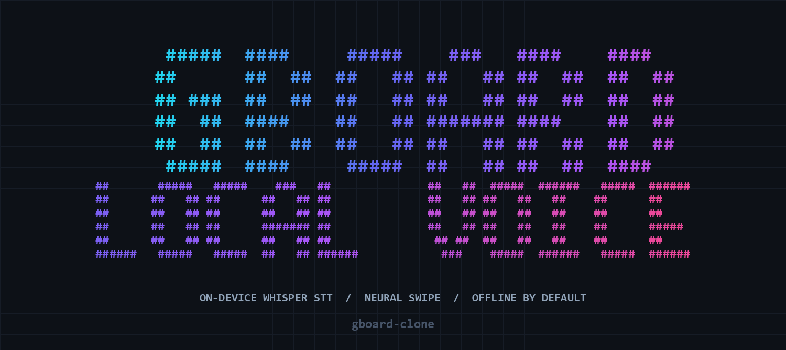

<p align="center">
  
</p>

<p align="center">
  <a href="#features"></a>
  <a href="#monorepo-layout"></a>
  <a href="#verification"></a>
  <a href="#build"></a>
  <a href="#license"></a>
</p>

An Android keyboard in the style of Gboard with **100% local voice dictation**.
Speech recognition runs on the device with **whisper.cpp** (Whisper `base`,
CPU), with no dependency on Google's speech service. Everything works offline,
including swipe typing and local dictionary correction.

---

## Features

- **Fully offline.** The model (`ggml-base.bin`, ~141 MB) is bundled in the
  assets and executed on the device through JNI (`libwhisper.so`). No network
  round-trip is required at any point.
- **Fast.** On-device inference takes roughly 0.3-0.6 s for short phrases on
  arm64. An optional OpenAI-compatible server backend can be enabled in the
  setup screen, with automatic fallback to the local model.
- **Portuguese by default.** Transcription uses `pt`; the `base` model is
  multilingual (99 languages) and the language is configurable.
- **Local dictionary correction.** Unknown ASR words are compared with a
  3,000-word pt-BR frequency dictionary (edit distance 1-2, accent-insensitive)
  and replaced by the most frequent candidate. This is the local analogue of
  Gboard's SmartDictation layer, implemented in `DictionaryCorrector.java`.
- **Neural swipe typing.** A trained model decodes the gesture trace into real
  dictionary words. The canonical model and the training data live in
  `packages/ai-model`.
- **Gboard-like UI.** Suggestion strip, Material key caps, light/dark themes,
  accented-character popups, double-tap Shift for caps lock, spacebar cursor
  glide, emoji picker and a three-page symbol layout.
- **Adaptive silence detection.** Dictation stops after ~1 s of silence using
  the measured background noise level, so a fan or air conditioner does not
  cut speech off.
- **Local usage log.** Typed keys, swipe traces, dictation results, commits and
  user corrections are appended to a JSONL file in the app cache so future
  training runs can pair model output with what the user actually kept.
  Nothing is uploaded. See [Usage telemetry](#usage-telemetry).

## Models

The two trained artifacts are published on Hugging Face under the `giofolf`
account. Both are multilingual and run fully on-device.

| Model | Hugging Face | Format | What it does |
| --- | --- | --- | --- |
| **OmniVox Lite** | [`giofolf/omnivox-lite`](https://huggingface.co/giofolf/omnivox-lite) | `ggml-base.bin` (~141 MB) | Whisper base for local speech recognition, bundled with the pt-BR correction dictionaries |
| **Omniglide** | [`giofolf/omniglide`](https://huggingface.co/giofolf/omniglide) | `swipe_model.bin` (~2 MB) | Neural swipe decoder trained on real Portuguese and English gesture traces |

Download them with the Hugging Face CLI:

```bash
hf download giofolf/omnivox-lite ggml-base.bin --local-dir .
hf download giofolf/omniglide swipe_model.bin --local-dir .
```

Model cards and license notes live in [`releases/omnivox-lite`](releases/omnivox-lite/README.md)
and [`releases/omniglide`](releases/omniglide/README.md). The release binaries
are kept out of git; only the cards are versioned.

## What this project is (REA)

This repository contains reverse-engineering analyses of the reference
products:

1. **`docs/REA_VOICE_CURSOR.md`**: analysis of Voice Cursor, its speech model
   (faster-whisper `base`/int8), its interaction model (push-to-talk plus live
   transcript) and the decision to port it to whisper.cpp on the device.
2. **`docs/REA_GBOARD.md`**: analysis of the real Gboard APK (decompiled with
   jadx), showing where Gboard calls Google STT and the exact replacement point
   implemented here.
3. **`docs/REA_GBOARD_UI.md`**: analysis of the Gboard keyboard UI, reconstructed
   in `aosp-base`.

The project reproduces the *behaviour* of Gboard, not its proprietary binary.
Google's code cannot be redistributed, so the integration points are documented
and independently reimplemented here.

## Monorepo layout

```
morrow/
├── packages/
│   ├── app/                          # setup/launcher app (dev.gti.gboard)
│   │   ├── build.gradle              # Android module (AGP 8.5.2, NDK 28, CMake)
│   │   ├── settings.gradle           # standalone Gradle build for this package
│   │   ├── gradlew, gradle/          # Gradle 8.9 wrapper
│   │   ├── src/main/
│   │   │   ├── AndroidManifest.xml   # activities, provider, RECORD_AUDIO
│   │   │   ├── assets/models/        # ggml-base.bin (~141 MB, gitignored)
│   │   │   ├── jni/whisper/          # CMakeLists.txt + jni.cpp (JNI bridge)
│   │   │   ├── java/dev/gti/gboard/  # SetupActivity, VoiceEngine, etc.
│   │   │   └── res/                  # strings, theme, icons
│   │   └── aosp-base/                # AOSP LatinIME (the installed keyboard)
│   │       ├── java/                 # LatinIME, KeyboardState, UsageLog, etc.
│   │       ├── native/               # AOSP dictionaries (JNI)
│   │       ├── whisper-jni/          # Whisper + swipe JNI (CMakeLists)
│   │       └── gradlew               # independent wrapper
│   └── ai-model/                     # everything related to AI
│       ├── whisper.cpp/              # vendored whisper.cpp + ggml (MIT)
│       ├── openswipe-engine/         # vendored swipe engine (MIT)
│       ├── gesture-training/         # swipe model training data and scripts
│       ├── swipe_model.bin           # trained neural swipe model (~2 MB)
│       ├── fetch-model.ps1           # downloads ggml-base.bin into app assets
│       └── prepare-aosp.ps1          # copies the model into aosp-base res/raw
└── docs/                             # REA artifacts, evidence and this README
    └── assets/banner.png             # rendered ASCII-art banner
```

## Prerequisites

- JDK 17 (`JAVA_HOME`)
- Android SDK with `platforms;android-34`, `build-tools;36.0.0`,
  `ndk;28.2.13676358`, `cmake;3.22.1` and `platform-tools`
- A Gradle wrapper is included in `packages/app` (Gradle 8.9), so no global
  Gradle installation is needed

## Build

Run the commands from `packages/app`, which owns its own Gradle build:

```powershell
cd packages/app

# 1. first build only: download the model into assets
powershell -ExecutionPolicy Bypass -File ..\ai-model\fetch-model.ps1

# 2. build the debug APK (3 ABIs: arm64-v8a, armeabi-v7a, x86_64)
.\gradlew.bat assembleDebug
# -> packages\app\build\outputs\apk\debug\app-debug.apk

# 3. optional: signed release APK
.\gradlew.bat assembleRelease
```

The keyboard itself is a separate Android application:

```powershell
cd packages\app\aosp-base
.\gradlew.bat assembleDebug
# -> packages\app\aosp-base\build\outputs\apk\debug\LatinIME-debug.apk
```

Both debug APKs are signed with Gradle's debug keystore and can be installed
directly with ADB.

## Install (ADB)

```bash
adb devices
adb install -r packages\app\build\outputs\apk\debug\app-debug.apk
adb install -r packages\app\aosp-base\build\outputs\apk\debug\LatinIME-debug.apk
adb shell ime set com.android.inputmethod.latin/.LatinIME
```

## Device setup

1. Open the **Gboard Local Voice** setup app.
2. **1) Enable keyboard** and tick "Gboard · Local Voice" under
   *Settings → Keyboard → Virtual keyboards*.
3. **2) Grant microphone** to allow `RECORD_AUDIO`.
4. **3) Test local dictation**: speak for about 4 s in Portuguese. The app
   records and transcribes **on the device** and displays the result, proving
   that Google's speech server is not involved.
5. Select the keyboard in any text field, press the mic key, speak, release,
   and the text is committed.

## Gboard-style interface

- Suggestion strip with three frequency-ranked words, toolbar and a colored mic
  button.
- Material key caps with rounded corners, pressed states and light/dark themes
  following the system.
- Tap inserts a character, long press opens accented popups, double-tap Shift
  toggles caps lock, spacebar glide moves the cursor, and horizontal swipe on
  the suggestion strip picks a word.
- A neural glide decoder replaces the geometric AOSP gesture fallback.
- Live stroke overlay shows the finger path and the decoded word while gliding.
- Three symbol pages (`ABC`, `?123`, `=\<`) plus an emoji picker.
- Dictation can be cancelled with an ✕ button before committing.
- Backspace repeats character by character when held.
- `TranscriptCleaner` removes Whisper artifacts such as `[BACKGROUND MUSIC]`.
- The waveform is driven by real microphone RMS, not a random animation.

## Usage telemetry

The IME appends structured events to
`/data/data/com.android.inputmethod.latin/cache/usage/usage_events.jsonl`:

| Event | Meaning |
| --- | --- |
| `key` | a key press, with code point and label |
| `swipe_decode` | downsampled gesture trace and raw decoder candidates |
| `swipe_top` | the top suggestion offered for the gesture |
| `voice` | raw dictation transcript, backend and measured inference time |
| `commit` | final text with its origin (`typed`, `swipe`, `voice`, `suggestion`) |
| `backspace` | deleted characters, linked to the commit being corrected |
| `suggestion_pick` | chosen word versus the original typed/swiped word |

Every event carries a timestamp, session id and sequence number, and ids link a
commit back to its gesture or dictation and forward to the corrections it
received. This is the structure needed to train the swipe model and the
corrector from real usage.

Data stays on the device. The log rotates at 4 MB. It can be disabled with the
`gti_usage_log` toggle in the setup app. A future release will add an opt-in
upload path to a server.

## Verification

- No Google STT socket is opened: the app never binds to a system speech
  service and never uses `android.speech.SpeechRecognizer`. The path is
  `AudioRecord → 16 kHz PCM → libwhisper.so (JNI) → text`.
- The setup screen self-test and the WAV test run the same pipeline as the
  keyboard. Trigger the WAV test headlessly with:
  `adb shell am start -n dev.gti.gboard/.SetupActivity --ez wavtest 1`.
- An emulator run in airplane mode produced a full transcription, which would
  be impossible with a network dependency. See
  `docs/evidence/device_selftest.md` and
  `docs/evidence/device_selftest_airplane.log`.
- Host-side verification with the same model: 6.8 s of Portuguese audio
  transcribes in about 1.5 s (RTF ≈ 0.22) with the network disabled. Exact
  commands and captured output are in `docs/VERIFICATION.md`.

## Unit tests

```powershell
cd packages/app
.\gradlew.bat testDebugUnitTest
```

26 JUnit tests cover transcript cleanup, waveform levels, glide tracking,
dictionary Levenshtein scoring and spatial decoder scoring. No device or
emulator is required.

## Notes and limitations

- The `base` model favours speed. For higher accuracy in pt-BR, replace the
  asset with `ggml-small` or `ggml-medium` (more RAM and latency); only
  `MODEL_ASSET`/`MODEL_FILE` in `VoiceEngine.java` needs to change.
- Live partial transcription uses the same context; on slow devices, increase
  `PARTIAL_EVERY_MS` in `DictationController.java`.
- The original Google Gboard and Samsung keyboards remain installed and are
  never modified.

## License

Third-party components are vendored under their own licenses:
whisper.cpp and ggml (MIT), OpenSwipe engine (MIT), and AOSP LatinIME
(Apache 2.0). See each vendored directory for its license file.
